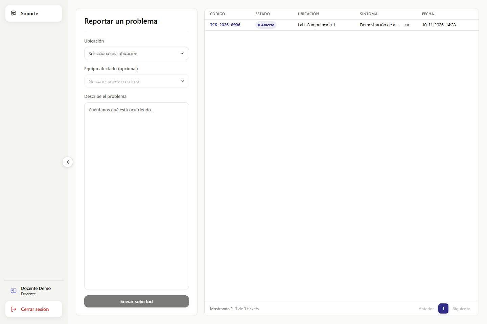
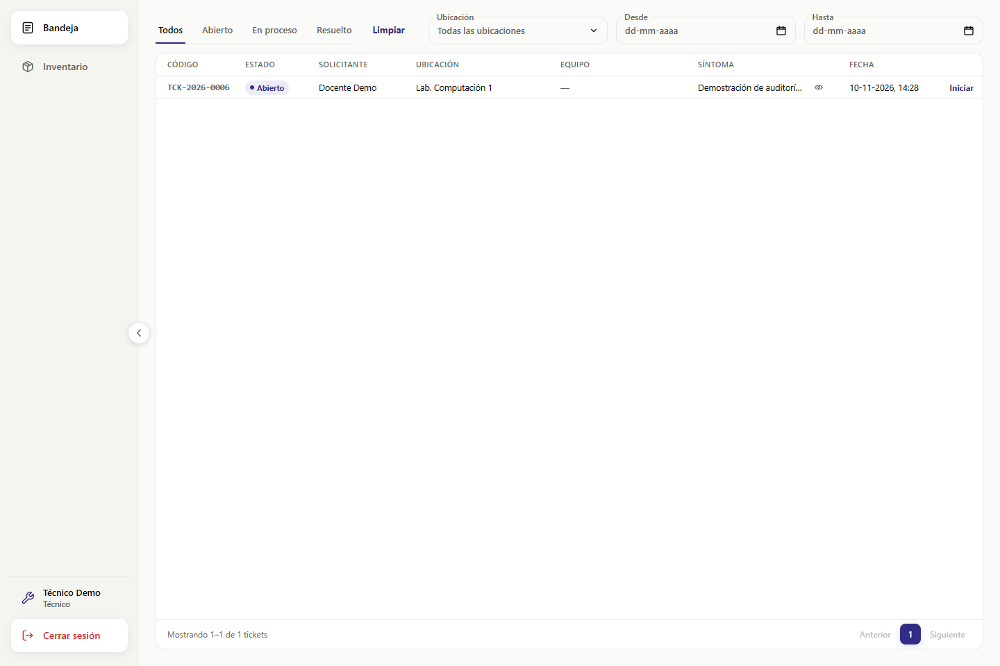
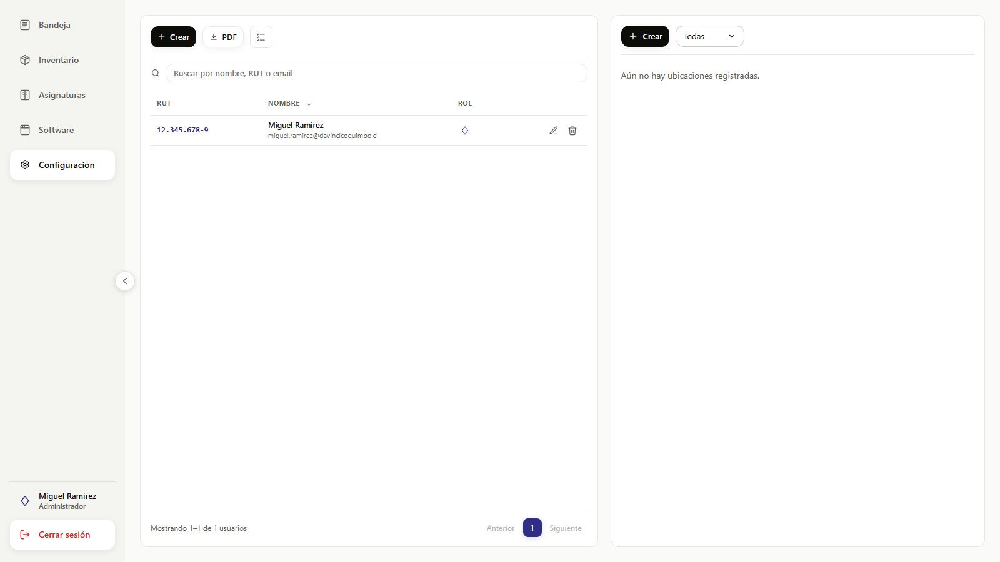

# Inventario y Soporte

Aplicación web para gestionar solicitudes de soporte, activos tecnológicos y catálogos académicos de un establecimiento educacional. Los docentes informan problemas, el personal técnico los atiende y registra una bitácora, y los administradores mantienen los datos maestros y las cuentas.

## Funciones por perfil

| Perfil | Vistas y acciones |
|---|---|
| Docente | Inicia sesión, crea tickets asociados a su propia cuenta y consulta su historial. |
| Técnico | Atiende la bandeja, cambia estados, registra causa y solución en la bitácora, consulta inventario y administra dispositivos. |
| Administrador | Tiene acceso a la bandeja e inventario, además de usuarios, ubicaciones, asignaturas, niveles y software educativo. |

## Capturas de la aplicación

Capturas del despliegue local con cuentas y tickets ficticios.

### Docente: crear y consultar tickets



### Técnico: bandeja de entrada



### Administrador: configuración



## Arquitectura

- **Frontend:** React 19, TypeScript y Vite. Componentes por página, servicios HTTP por dominio, tipos compartidos y estilos en `frontend/src/`.
- **Backend:** NestJS 12 con módulos de autenticación, usuarios, tickets, inventario, ubicaciones, asignaturas/niveles y software.
- **Persistencia:** PostgreSQL 16 y TypeORM. Las migraciones están en `backend/src/database/migrations/`; `DB_SYNCHRONIZE` queda desactivado.
- **Despliegue:** Docker Compose. En producción Nginx sirve los archivos estáticos y enruta `/api` al backend; el backend y PostgreSQL no publican puertos en el host.

Para el recorrido detallado de solicitudes y permisos, consulta [`docs/arquitectura-y-funcionamiento.md`](docs/arquitectura-y-funcionamiento.md). Para el modelo conceptual, lógico y físico consulta [`docs/modelo-de-datos.md`](docs/modelo-de-datos.md).

## Requisitos

- Node.js 24 y npm para el modo local.
- Docker Desktop / Docker Compose v2 para el despliegue en contenedores.
- Una instancia PostgreSQL si se ejecuta backend y frontend fuera de Docker.

## Configuración local

Configura variables de entorno usando los ejemplos incluidos. No copies credenciales de ejemplo a una instalación productiva.

```powershell
Copy-Item .env.example .env
Copy-Item backend/.env.example backend/.env
```

Completa los secretos y credenciales exigidos en los archivos locales sin versionarlos. No compartas `JWT_SECRET`, contraseñas de PostgreSQL ni respaldos sin cifrar.

### Desarrollo con Docker Compose

```powershell
docker compose up -d --build
```

Servicios de desarrollo: frontend `http://localhost:5173`, API `http://localhost:3000`, PostgreSQL `localhost:5432` y pgAdmin `localhost:5050`. El arranque aplica migraciones y crea el administrador base desde `SYS_ADMIN_PASSWORD` y `SYS_ADMIN_NOMBRE`. Para cargar datos de demostración: `docker compose exec backend npm run seed`.

### Ejecución por separado

```powershell
# Terminal 1
cd backend
npm ci
npm run migration:run
npm run start:dev

# Terminal 2
cd frontend
npm ci
npm run dev
```

Para la conexión local, revisa `backend/.env.example`.

## Base de datos, migraciones y seed

Las migraciones crean el esquema y aplican cambios versionados. Una base nueva se inicializa con `npm run migration:run`. Una base antigua creada con `synchronize` requiere marcar la migración inicial mediante `npm run migration:baseline` antes de aplicar migraciones posteriores. No uses `migration:revert` como mecanismo de recuperación de datos.

```powershell
cd backend
npm run migration:show
npm run migration:run
npm run seed
```

El seed es idempotente y contiene datos de demostración, con credenciales iniciales basadas en RUT. Úsalo solo en desarrollo o staging. La política de respaldo/restauración está en [`docs/operacion-produccion-postgres.md`](docs/operacion-produccion-postgres.md).

### Administrador base

El arranque productivo crea el usuario `ADMIN` solo si no hay otro. No sobrescribe credenciales ni eleva privilegios. Las variables obligatorias son `SYS_ADMIN_PASSWORD` (valor previsto: RUT sin puntos) y `SYS_ADMIN_NOMBRE`; `SYS_ADMIN_RUT` y `SYS_ADMIN_EMAIL` son opcionales. Cambia la contraseña tras el primer ingreso. Ejecución manual: `npm run bootstrap:admin` en `backend`.

### Carga de datos por dominio (CLI)

Los comandos por dominio son idempotentes y funcionan también en producción:

```powershell
cd backend
npm run seed:catalogos      # ubicaciones, niveles, asignaturas y software
npm run seed:dispositivos   # ubicaciones y 37 dispositivos de demostración
```

En contenedores: `docker compose -f compose.prod.yml exec backend node dist/database/run-seed-domain.js catalogos` (o `dispositivos`). Ninguno crea usuarios. El seeder de usuarios poda cuentas fuera de su padrón: queda reservado a desarrollo y staging. Los dispositivos son datos de ejemplo.

## Módulos funcionales

- **Autenticación:** selección de usuario por nombre, contraseña y JWT. La política actual acepta RUT sin puntos o fecha de nacimiento en formato `DDMMYYYY`.
- **Tickets:** creación docente, bandeja para técnico/administrador, filtros y paginación. Técnicos y administradores reciben un toast en cualquier ruta y la bandeja se actualiza en tiempo real al crearse tickets. La resolución requiere registrar causa raíz y solución aplicada; si hay un dispositivo relacionado, se registra su estado final.
- **Bitácora:** conserva la información de resolución y ofrece una representación imprimible/PDF asociada al código del ticket.
- **Inventario:** altas, cambios y bajas de dispositivos con código generado a partir del tipo y ubicación, búsqueda, filtros y paginación.
- **Catálogos:** administración de ubicaciones, niveles, asignaturas y software educativo; las asignaturas se relacionan con niveles y el software con asignaturas.
- **Configuración:** administración de usuarios y datos de ubicación, reservada al perfil administrador.

## API principal

El prefijo del proxy de producción es `/api`; localmente el backend escucha en `:3000`. Las rutas protegidas exigen `Authorization: Bearer <token>`.

| Método | Ruta | Permiso | Uso |
|---|---|---|---|
| `POST` | `/auth/login` | Público, limitado por tasa | Obtener un JWT. |
| `GET` | `/auth/users` | Público, limitado por tasa | Cargar los nombres disponibles en el login. |
| `GET` | `/auth/me` | Autenticado | Consultar el perfil vigente. |
| `GET`, `POST` | `/tickets` | Docente | Ver tickets propios y crear solicitudes. |
| `GET` | `/tickets/inbox` | Técnico, administrador | Consultar la bandeja. |
| `GET` | `/tickets/events` | Técnico, administrador | Canal SSE autenticado: avisa cuando se crea un ticket. |
| `PATCH` | `/tickets/:id_ticket/status` | Técnico, administrador | Cambiar estado según las transiciones permitidas. |
| `PATCH` | `/tickets/:id_ticket` | Técnico, administrador | Resolver y guardar la bitácora. |
| `GET` | `/tickets/:id_ticket/bitacora` | Técnico, administrador | Obtener datos de bitácora. |
| `/inventory/*` | `GET`, `POST`, `PATCH`, `DELETE` | Según endpoint: lectura compartida o técnico/administrador | Consultar opciones o gestionar activos. |
| `/users/*`, `/locations/*`, `/levels/*`, `/subjects/*`, `/software/*` | CRUD | Administrador para escritura; lectura compartida donde corresponda | Mantener usuarios y catálogos. |
| `GET` | `/health` | Público | Comprobar proceso y conexión a PostgreSQL (`SELECT 1`). |

Consulta cada controlador en `backend/src/*/*.controller.ts` para el contrato exacto, parámetros y estados HTTP. No hay documentación OpenAPI.

## Pruebas y calidad

```powershell
# Backend
cd backend
npm run lint
npm run typecheck
npm run test
npm run test:e2e
npm run build

# Frontend
cd ../frontend
npm run lint
npm run build
```

El workflow de GitHub Actions ejecuta lint, typecheck, unitarios y build; el job e2e prepara PostgreSQL y corre migraciones y pruebas HTTP. Esas pruebas e2e usan dobles de servicios y repositorios: no cubren el negocio sobre PostgreSQL.

## Despliegue productivo

El compose productivo aplica las migraciones, crea el administrador base y solo entonces arranca el backend.

### Build de producción (paso a paso)

**1. Variables de entorno.** En `.env` (raíz), obligatorias:

| Variable | Uso |
|---|---|
| `POSTGRES_USER`, `POSTGRES_PASSWORD`, `POSTGRES_DB` | Credenciales y nombre de la base de datos |
| `JWT_SECRET` | Firma de tokens; mínimo 32 caracteres |
| `SYS_ADMIN_PASSWORD` | Contraseña inicial del administrador base (valor previsto: RUT sin puntos) |
| `SYS_ADMIN_NOMBRE` | Nombre con el que aparece el administrador en el login |

Opcionales: `SYS_ADMIN_RUT`, `SYS_ADMIN_EMAIL`, `JWT_EXPIRES_IN` y `CORS_ORIGIN` (vacío = mismo origen). No hacen falta `PGADMIN_*`, porque este compose no levanta pgAdmin, ni `DB_SYNCHRONIZE`/`DB_MIGRATIONS_RUN`, que quedan fijados en `false`.

**2. Validar la configuración.**

```powershell
docker compose -f compose.prod.yml config --quiet
```

**3. Construir las imágenes (opcional).**

```powershell
docker compose -f compose.prod.yml build
```

`up -d --build` ya las construye; este paso permite compilar sin desplegar. Los `Dockerfile` compilan dentro de la imagen.

**4. Desplegar.**

```powershell
docker compose -f compose.prod.yml up -d --build
```

El orden de arranque es `postgres` → `migrate` → `bootstrap-admin` → `backend` → `frontend`. Solo se publica el frontend en `:80`; el backend y PostgreSQL quedan en la red interna.

**5. Verificar.**

```powershell
docker compose -f compose.prod.yml ps
docker compose -f compose.prod.yml logs migrate bootstrap-admin
curl http://localhost/health
curl http://localhost/
```

`migrate` y `bootstrap-admin` deben terminar con código 0; `backend` y `frontend` deben estar healthy; `/health` responde `ok` (Nginx lo proxya a `backend:3000/health`).

**6. Carga opcional de datos.**

```powershell
docker compose -f compose.prod.yml exec backend node dist/database/run-seed-domain.js catalogos
```

Sustituye `catalogos` por `dispositivos` para cargar el inventario de ejemplo. Detalles en "Carga de datos por dominio (CLI)".

La publicación incluye HTTP en el puerto 80. Termina TLS en un proxy/balanceador confiable antes de exponer el sitio; configura también dominio, certificados, respaldos cifrados fuera del host, alertas y un simulacro periódico de restauración.

## Seguridad y operación

- Rutas por rol verificadas en backend; ocultar un enlace del menú no sustituye RBAC.
- El token se guarda en `sessionStorage`, o en `localStorage` si se selecciona “Recordar usuario”.
- Las fechas de nacimiento se cifran en base de datos para permitir su edición y también se guardan como hash para validar acceso.
- `DB_SYNCHRONIZE` debe permanecer desactivado en producción.

## Directorios

```text
backend/          API NestJS, entidades, migraciones, seed y pruebas
frontend/         SPA React, servicios HTTP, tipos, vistas y estilos
docs/             operación, arquitectura y modelo de datos
docs/screenshots/ capturas de docente, técnico y administrador con datos ficticios
.github/workflows/ CI
```
