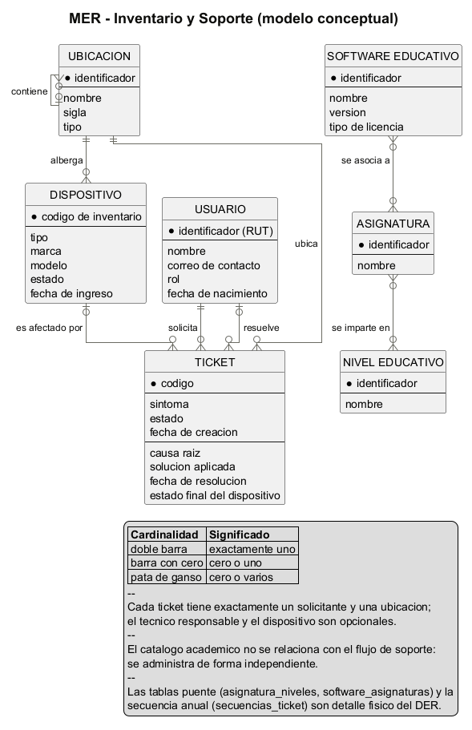

# Modelo de datos — MER, DER y esquema físico

## 1. Alcance y convención

- El **MER** presenta los conceptos y relaciones del negocio sin acoplarlos a tipos de columna.
- El **DER** muestra entidades, cardinalidades y atributos principales.

Los diagramas versionados están en `docs/db/`: `MER-base-de-datos.png` y `DER-base-de-datos.pdf`. No se generan desde una fuente versionada: se importan tal cual.

## 2. MER

Este MER muestra los conceptos del negocio, los verbos de sus relaciones y sus cardinalidades. Los atributos son conceptuales, no tipos ni columnas SQL.

Cada ticket tiene exactamente un solicitante y una ubicación; puede no tener dispositivo ni técnico responsable antes de resolverse. La causa raíz, la solución, el estado final del dispositivo y la fecha de resolución se guardan en el propio ticket: la bitácora no es una tabla independiente ni mantiene eventos múltiples. El solicitante y quien resuelve son roles de `USUARIO`; solo administración y soporte técnico pueden resolver tickets. Cada ubicación puede tener cero o un padre y contener varias sububicaciones. Las asignaturas se imparten en varios niveles y el software puede asociarse a varias asignaturas, y viceversa.

El catálogo académico y el soporte no se relacionan en el modelo. `secuencias_ticket` es un mecanismo técnico para el correlativo anual y tampoco aparece en el MER.

## 3. DER

El esquema físico está en [DER-base-de-datos.pdf](db/DER-base-de-datos.pdf). Es una exportación puntual, sin fuente versionada.

TypeORM también crea la tabla técnica `migrations` para registrar los cambios aplicados.

## 4. Tipos enumerados

| Enum | Valores observados |
|---|---|
| `user_role` | `ADMIN`, `TECNICO`, `DOCENTE` |
| `ticket_status` | `ABIERTO`, `EN_PROCESO`, `RESUELTO` |
| `device_status` | `ACTIVO`, `INACTIVO`, `BAJA_TECNICA` |
| `device_type` | `PC`, `PROYECTOR`, `IMPRESORA`, `RED` |
| `software_licencia` | `LIBRE`, `GRATUITA`, `COMERCIAL`, `SUSCRIPCION`, `FREEMIUM` |

## 5. Migraciones actuales

1. `InitialSchema1793836800000`: Crea enums, tablas, secuencias, PK, restricciones de unicidad e índices iniciales.
2. `AddTicketForeignKeys1794206787051`: Busca registros huérfanos antes de crear las FKs del solicitante y el dispositivo.
3. `AddLoginIdentityAndBirthDate1794242248001`: Añade UUID `login_id` y hash de fecha de nacimiento.
4. `AddEncryptedBirthDate1794244713692`: Añade la columna para fecha cifrada.
5. `RelateDomainTables1794352000000`: Migra nombres de ubicación a IDs, enlaza tickets con su secuencia anual y agrega las FKs de ubicaciones y tablas puente.
6. `AddTicketTechnician1794360000000`: Registra la referencia al usuario que resuelve el ticket y agrega un índice; mantiene el nombre como snapshot.

Las migraciones que crean claves foráneas validan primero las referencias huérfanas y abortan si las hay.

## 6. Datos iniciales

Los seeders están separados por dominio y se coordinan en `backend/src/seed.ts`. Cargan datos de demostración: ubicaciones, dispositivos, niveles, asignaturas, software y usuarios con credenciales iniciales basadas en RUT. El seed completo se usa solo en desarrollo y staging. En producción, `npm run seed:catalogos` y `npm run seed:dispositivos` cargan catálogos e inventario sin crear usuarios.
